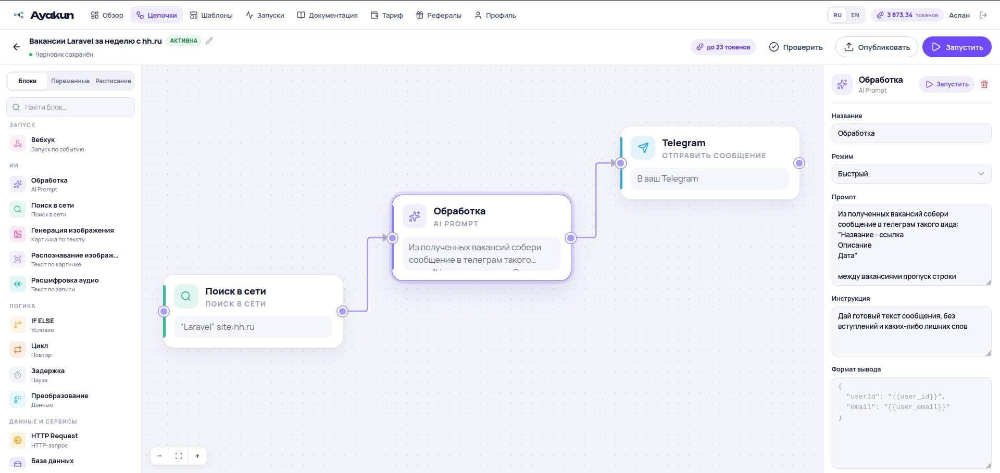
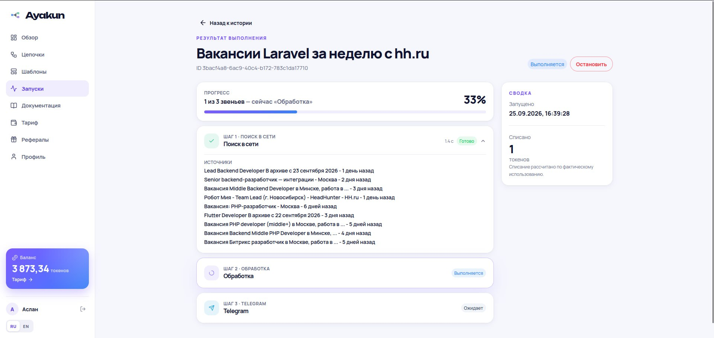
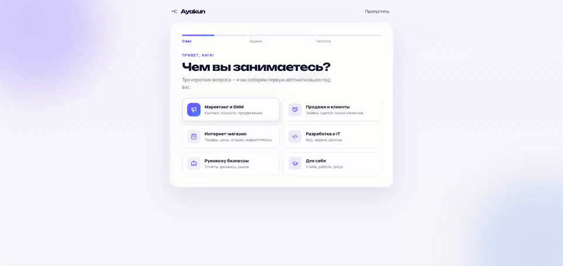
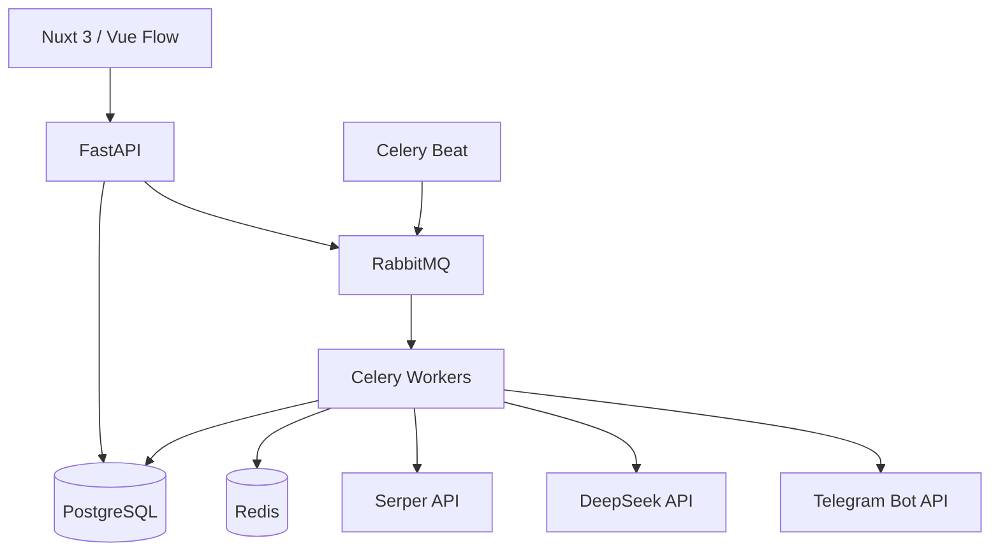
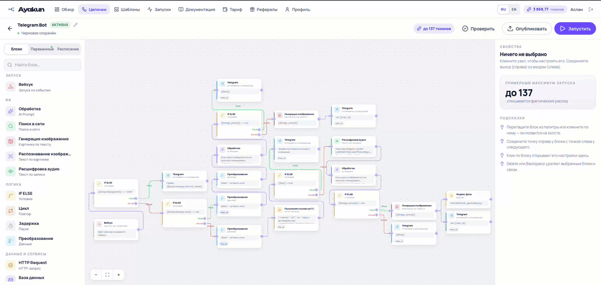

# Ayakun

### Визуальная платформа для создания и запуска AI-автоматизаций без кода

[](https://nuxt.com/)
[](https://fastapi.tiangolo.com/)
[](https://www.postgresql.org/)
[](https://docs.celeryq.dev/)
[](https://docs.docker.com/compose/)

<p align="center">
  
</p>

Ayakun позволяет собрать рабочий процесс из визуальных блоков: найти данные в интернете, обработать их с помощью LLM и отправить готовый результат в Telegram, Slack, почту или CRM. Цепочки запускаются вручную, по расписанию или по вебхуку, а каждый запуск сохраняет подробную историю выполнения.

Не нужны собственные подписки на ИИ-сервисы: Ayakun сам оплачивает провайдеров, а пользователь платит за тариф картой и тратит внутренние токены (credits).

## Главные особенности

- **Визуальный workflow-редактор.** Узлы соединяются в ориентированный ациклический граф с проверкой связей и зависимостей.
- **25 типов блоков.** ИИ, логика, данные, файлы и интеграции — от поиска в сети и генерации изображений до Битрикс24 и Jira. [Полный список](#блоки).
- **Онбординг за три вопроса.** Сервис сам собирает первую цепочку под вашу цель и настраивает расписание. [Подробнее](#онбординг).
- **42 готовых шаблона.** Сценарии для продаж, контента, мониторинга и разработки копируются в ваши цепочки одним кликом. [Подробнее](#готовые-шаблоны).
- **Версионирование цепочек.** Черновик можно изменять независимо от опубликованной версии; каждый запуск использует неизменяемый snapshot.
- **Асинхронное выполнение.** Celery workers, RabbitMQ и Redis обеспечивают надёжную обработку фоновых и запланированных задач.
- **Умный LLM-бюджет.** Входные данные оцениваются локальным DeepSeek tokenizer, а допустимый размер ответа рассчитывается автоматически.
- **Billing по фактическому usage.** Учитываются cache-hit, cache-miss и output tokens LLM, а не приблизительное число символов.
- **Защита от перерасхода.** Атомарные reservations и блокировки PostgreSQL не позволяют параллельным запускам потратить один баланс дважды.
- **Прозрачная стоимость.** До запуска пользователь видит оценку в credits, после выполнения списывается реальная стоимость на основе расчета прайсингов провайдеров.
- **Идемпотентность и аудит.** Финансовые операции имеют `request_id`, журналируются и безопасно переживают повторную доставку задач.
- **Несколько способов входа.** Email, Google OAuth и Telegram.
- **Доставка результатов.** Готовые отчёты автоматически отправляются в Telegram, Slack, на почту, в таблицы и CRM.

## Как это выглядит

Цепочка из трёх блоков: поиск вакансий в сети → ИИ собирает из них список сообщений → отправка в Telegram по расписанию.



Запуск цепочки отображается в реальном времени: прогресс по звеньям, источники, найденные поиском, длительность каждого шага и фактическое списание токенов.



## Онбординг

Новому пользователю не нужно разбираться в редакторе с нуля. При первом входе Ayakun задаёт несколько вопросов и **сам собирает готовую цепочку под цель человека**:

1. **Чем вы занимаетесь?** Маркетинг и SMM, продажи, интернет-магазин, разработка и IT, руководство бизнесом или «для себя».
2. **Что хотите автоматизировать?** Для каждой роли — свои задачи: дайджест новостей ниши, заявки с сайта в таблицу, цены конкурентов, сводка для стендапа из Jira, курсы валют, поиск вакансий и другие.
3. **Как часто это нужно?** Каждый час, каждый день, по будням, раз в неделю или только вручную, плюс время отправки.

По ответам подбирается подходящий [шаблон](#готовые-шаблоны), он копируется в цепочки пользователя, настраивается расписание, и открывается редактор — остаётся только проверить цепочку и запустить её.



## Готовые шаблоны

В галерее **42 готовых сценария** в шести категориях: контент, продажи, операции, мониторинг, задачи и разработка, фото и медиа. Шаблон копируется в ваши цепочки вместе с блоками, условиями и переменными — остаётся подключить свои сервисы и ключи.

Примеры:

- дайджест новостей ниши в Telegram и пост для канала с проверкой;
- заявка с сайта по вебхуку → таблица и Telegram, лид в Битрикс24, карточка в Trello и Slack, оценка лида ИИ и ответ клиенту;
- ежедневный отчёт о продажах из базы данных с выводами ИИ;
- слежение за ценами и новостями конкурентов, поиск тендеров и вакансий;
- баг-репорт с сайта → задача в Jira, сводка для стендапа и заметки о релизах в Slack;
- фото чека → строка расходов в Excel, продающее описание товара по фото.

## Блоки

В редакторе доступно **25 блоков**. В палитре они сгруппированы так:

### Запуск

| Блок | Что делает |
| --- | --- |
| **Вебхук** | Стартовый узел: внешний сервис вызывает URL — и цепочка запускается. |

### ИИ

| Блок | Что делает |
| --- | --- |
| **Обработка** (AI Prompt) | Отправляет текст в ИИ: сжать, отобрать, переписать или вернуть JSON по заданной схеме. |
| **Поиск в сети** | Ищет в интернете по запросу и отдаёт список найденных страниц, с ограничением по свежести. |
| **Генерация изображения** | Превращает текстовый промпт в картинку. |
| **Распознавание изображения** | Читает картинку и возвращает текст. |
| **Расшифровка аудио** | Превращает аудиозапись или ссылку на неё в текст. |

### Логика

| Блок | Что делает |
| --- | --- |
| **IF ELSE** | Ветвит цепочку: условие истинно — выход TRUE, иначе FALSE. |
| **Цикл** | Проходит массив, считает от 1 до N или сравнивает переменную цепочки. |
| **Задержка** | Ставит цепочку на паузу перед следующим блоком. |
| **Преобразование** | Меняет JSON предыдущего шага: оставить поля, переименовать, отфильтровать, отсортировать. |

### Данные и сервисы

| Блок | Что делает |
| --- | --- |
| **HTTP Request** | Вызывает любой HTTP API: CRM, курс валют, вашу админку. |
| **База данных** | SQL-запросы к PostgreSQL, MySQL и ClickHouse. |
| **Google Таблицы** | Читает, добавляет и обновляет строки таблицы. |
| **Excel** | Читает и записывает книгу в OneDrive / Microsoft 365. |

### Файлы

| Блок | Что делает |
| --- | --- |
| **Файл** | Загружает файл с компьютера в цепочку. |
| **Таблица** | Читает CSV и XLSX в массив строк или собирает файл из данных. |
| **Изображение** | Выбирает одну картинку: загруженный файл, ссылку, сгенерированное изображение или файл с Яндекс Диска. |
| **Яндекс Диск** | Загружает файлы на диск и скачивает их. |

### Отправка и задачи

| Блок | Что делает |
| --- | --- |
| **Telegram** | Отправляет сообщение вам или в указанный чат. |
| **Email** | Отправляет письмо на указанный адрес. |
| **Slack** | Пишет в канал через входящий вебхук или от имени бота. |
| **LinkedIn** | Публикует пост от имени человека или страницы компании. |
| **Trello** | Создаёт и переносит карточки, читает список, пишет комментарии. |
| **Jira** | Создаёт задачи в Jira Cloud, ищет их по JQL, добавляет комментарии. |
| **Битрикс24** | Создаёт, обновляет, ищет и удаляет лиды, сделки, контакты и компании в CRM. |

Блоки ветвления и циклы доступны только в редакторе на компьютере; на телефоне цепочку можно собрать списком шагов и запустить.

## Как работает цепочка


Каждый узел хранит ссылки на родителей и потомков, подобно двусвязному списку. Перед публикацией проверяется структура графа, отсутствие циклов и корректность зависимостей. Worker выполняет узлы в топологическом порядке и передаёт результаты родителей следующим шагам.

## Архитектура



### Frontend

- Nuxt 3, Vue 3 и TypeScript
- Nuxt UI и Tailwind CSS
- Vue Flow для интерактивного DAG-редактора
- Реактивный мониторинг запусков и результатов
- Адаптивный интерфейс личного кабинета

### Backend

- FastAPI и Pydantic
- SQLAlchemy 2 с asyncpg
- PostgreSQL и Alembic migrations
- Celery, RabbitMQ и Redis
- JWT access/refresh authentication
- Интеграции с DeepSeek, Serper, Telegram, Google OAuth и YooKassa

## Credit billing

Ayakun скрывает технические параметры моделей от пользователя. Система сама:

1. Определяет доступный бюджет запуска с учётом баланса и тарифа.
2. Атомарно резервирует credits перед обращением к провайдерам.
3. Оценивает входные токены локально.
4. Рассчитывает безопасный лимит ответа.
5. Выполняет один LLM-запрос без автоматических продолжений.
6. Списывает стоимость по фактическому usage.
7. Освобождает неиспользованную часть резерва.

Даже несколько одновременных workflow не могут увести баланс в минус.

## Структура проекта

```text
.
├── frontend/                 # Nuxt-приложение и визуальный редактор
├── backend/app/
│   ├── api/v1/              # REST API
│   ├── models/              # SQLAlchemy-модели
│   ├── schemas/             # Pydantic-схемы
│   ├── services/            # Бизнес-логика и интеграции
│   ├── execution/           # Celery tasks и workflow runtime
│   ├── alembic/             # Миграции базы данных
│   └── tests/               # Unit и integration tests
├── docs/                    # Техническая документация
├── assets/readme/           # GIF и скриншоты для README
└── docker-compose.yml
```

## Быстрый запуск

Требования: Docker и Docker Compose.

```bash
cp .env.example .env
```

Заполните обязательные секреты и ключи провайдеров в `.env`, затем выполните:

```bash
docker compose build
docker compose up -d postgres redis rabbitmq
docker compose --profile migrate run --rm migrate
docker compose up -d
```

После запуска:

- приложение: `http://localhost:3000`
- OpenAPI: `http://localhost:8000/docs`
- RabbitMQ Management: `http://localhost:15672`

## Тестирование

Backend:

```bash
cd backend/app
uv sync --dev
uv run pytest -q
```

Frontend:

```bash
cd frontend
npm install
npm run typecheck
npm run build
```

Тесты покрывают расчёт credits, tokenizer, лимиты LLM, идемпотентность операций и конкурентное резервирование баланса.

## Пример применения

Цепочка мониторинга рынка может ежедневно:

1. Найти свежие новости и публикации конкурентов.
2. Выделить ключевые события и сформировать краткий отчёт.
3. Отправить результат ответственному сотруднику в Telegram.

## Пример: Telegram-бот с ИИ-ассистентом

Цепочка из множества блоков превращается в полноценного Telegram-бота. Вебхук принимает сообщения клиента, а ветвления IF ELSE выбирают сценарий:

- на текстовый вопрос бот отвечает как ИИ-ассистент;
- голосовое сообщение скачивается, расшифровывается блоком «Расшифровка аудио» и обрабатывается так же, как текст;
- если в сообщении есть просьба нарисовать картинку, ИИ определяет это, блок «Генерация изображения» создаёт изображение, а бот присылает его в чат.


