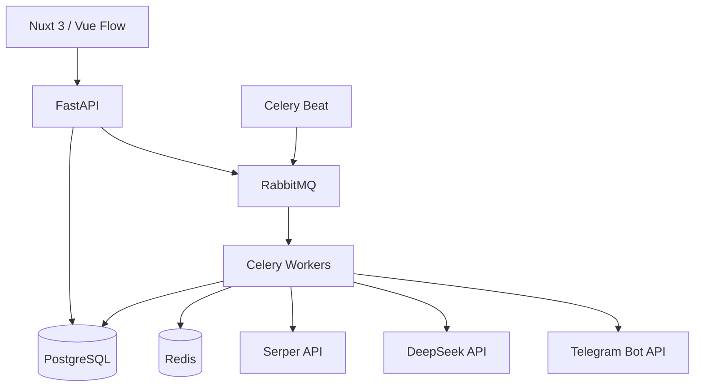

# Ayakun

### Визуальная платформа для создания и запуска AI-автоматизаций без кода

[](https://nuxt.com/)
[](https://fastapi.tiangolo.com/)
[](https://www.postgresql.org/)
[](https://docs.celeryq.dev/)
[](https://docs.docker.com/compose/)

Ayakun позволяет собрать рабочий процесс из визуальных блоков: найти данные в интернете, обработать их с помощью LLM и отправить готовый результат в Telegram. Цепочки запускаются вручную или по расписанию, а каждый запуск сохраняет подробную историю выполнения.

## Главные особенности

- **Визуальный workflow-редактор.** Узлы соединяются в ориентированный ациклический граф с проверкой связей и зависимостей.
- **Версионирование цепочек.** Черновик можно изменять независимо от опубликованной версии; каждый запуск использует неизменяемый snapshot.
- **Асинхронное выполнение.** Celery workers, RabbitMQ и Redis обеспечивают надёжную обработку фоновых и запланированных задач.
- **Умный LLM-бюджет.** Входные данные оцениваются локальным DeepSeek tokenizer, а допустимый размер ответа рассчитывается автоматически.
- **Billing по фактическому usage.** Учитываются cache-hit, cache-miss и output tokens LLM, а не приблизительное число символов.
- **Защита от перерасхода.** Атомарные reservations и блокировки PostgreSQL не позволяют параллельным запускам потратить один баланс дважды.
- **Прозрачная стоимость.** До запуска пользователь видит оценку в credits, после выполнения списывается реальная стоимость на основе расчета прайсингов провайдеров.
- **Идемпотентность и аудит.** Финансовые операции имеют `request_id`, журналируются и безопасно переживают повторную доставку задач.
- **Несколько способов входа.** Email, Google OAuth и Telegram.
- **Доставка результатов.** Готовые отчёты автоматически отправляются в Telegram.

## Как работает цепочка


Каждый узел хранит ссылки на родителей и потомков, подобно двусвязному списку. Перед публикацией проверяется структура графа, отсутствие циклов и корректность зависимостей. Worker выполняет узлы в топологическом порядке и передаёт результаты родителей следующим шагам.

## Архитектура



### Frontend

- Nuxt 3, Vue 3 и TypeScript
- Nuxt UI и Tailwind CSS
- Vue Flow для интерактивного DAG-редактора
- Реактивный мониторинг запусков и результатов
- Адаптивный интерфейс личного кабинета

### Backend

- FastAPI и Pydantic
- SQLAlchemy 2 с asyncpg
- PostgreSQL и Alembic migrations
- Celery, RabbitMQ и Redis
- JWT access/refresh authentication
- Интеграции с DeepSeek, Serper, Telegram, Google OAuth и YooKassa

## Credit billing

Ayakun скрывает технические параметры моделей от пользователя. Система сама:

1. Определяет доступный бюджет запуска с учётом баланса и тарифа.
2. Атомарно резервирует credits перед обращением к провайдерам.
3. Оценивает входные токены локально.
4. Рассчитывает безопасный лимит ответа.
5. Выполняет один LLM-запрос без автоматических продолжений.
6. Списывает стоимость по фактическому usage.
7. Освобождает неиспользованную часть резерва.

Даже несколько одновременных workflow не могут увести баланс в минус.

## Структура проекта

```text
.
├── frontend/                 # Nuxt-приложение и визуальный редактор
├── backend/app/
│   ├── api/v1/              # REST API
│   ├── models/              # SQLAlchemy-модели
│   ├── schemas/             # Pydantic-схемы
│   ├── services/            # Бизнес-логика и интеграции
│   ├── execution/           # Celery tasks и workflow runtime
│   ├── alembic/             # Миграции базы данных
│   └── tests/               # Unit и integration tests
├── docs/                    # Техническая документация
└── docker-compose.yml
```

## Быстрый запуск

Требования: Docker и Docker Compose.

```bash
cp .env.example .env
```

Заполните обязательные секреты и ключи провайдеров в `.env`, затем выполните:

```bash
docker compose build
docker compose up -d postgres redis rabbitmq
docker compose --profile migrate run --rm migrate
docker compose up -d
```

После запуска:

- приложение: `http://localhost:3000`
- OpenAPI: `http://localhost:8000/docs`
- RabbitMQ Management: `http://localhost:15672`

## Тестирование

Backend:

```bash
cd backend/app
uv sync --dev
uv run pytest -q
```

Frontend:

```bash
cd frontend
npm install
npm run typecheck
npm run build
```

Тесты покрывают расчёт credits, tokenizer, лимиты LLM, идемпотентность операций и конкурентное резервирование баланса.

## Пример применения

Цепочка мониторинга рынка может ежедневно:

1. Найти свежие новости и публикации конкурентов.
2. Выделить ключевые события и сформировать краткий отчёт.
3. Отправить результат ответственному сотруднику в Telegram.

Пользователю не нужно писать интеграционный код, управлять очередями или вручную контролировать выполнение.

---

**Ayakun** демонстрирует полный цикл AI-продукта: визуальный frontend, типизированный API, фоновые задачи, DAG execution, интеграции с внешними провайдерами, безопасную аутентификацию и конкурентно-безопасный billing.
